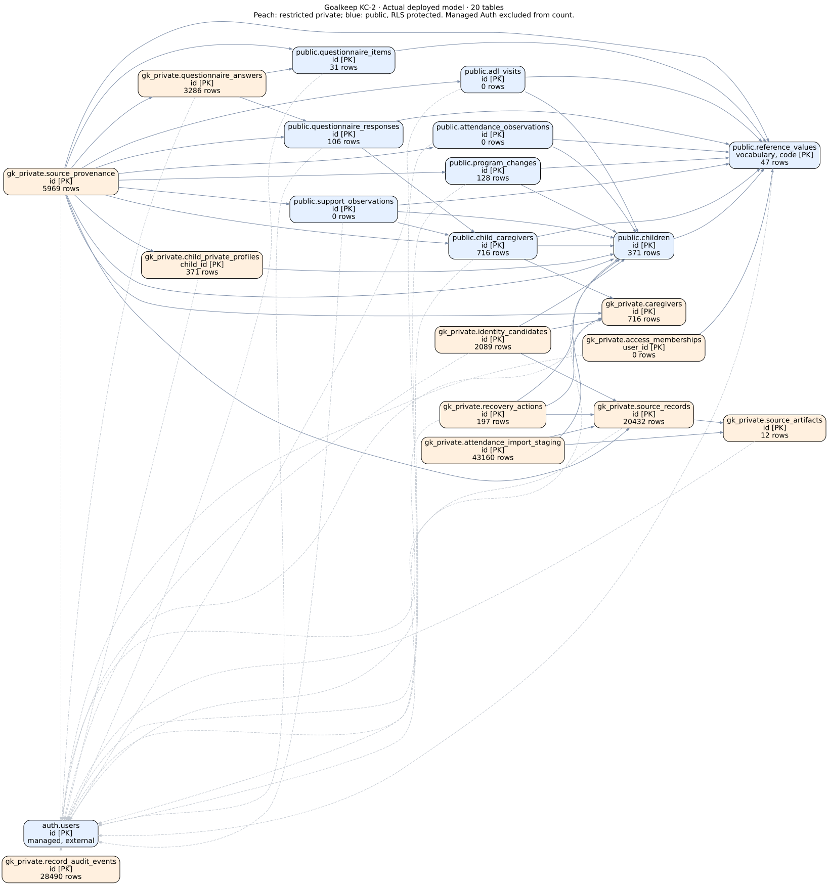

# Goalkeep KC-2 Integrated Data System

Phase 1 PostgreSQL backend for traceable NGO records, historical evidence and future data-entry/analytics workflows. **Technical delivery is ready for senior review; business-approved historical operational migration remains incomplete.**

Start with the [Phase 1 PM handover](docs/PHASE1-HANDOVER.md) and [senior review checklist](docs/PM-REVIEW-CHECKLIST.md).

## Actual deployed database

Supabase `kc2-integrated-data-system` (`hmlbdozsqxlwzvjimjwh`), Tokyo `ap-northeast-1`, non-production pilot. Tokyo is the owner's documented exception to the original Mumbai standard. Twenty application tables / 363 columns / 103 foreign keys; all RLS enabled. Private entities are restricted. OAuth, memberships and broad application access remain inactive.



- [Full Mermaid ER](docs/visual/final-deployed-er.mmd), [simplified business view](docs/visual/final-business-relationships.svg), [source flow](docs/visual/final-source-flow.svg).
- [Final data dictionary](docs/FINAL-DATA-DICTIONARY.md), [live counts and complete PK/FK reference](docs/FINAL-TABLE-INVENTORY.md).
- [Actual live verification](docs/evidence/phase1-final-delivery-verification.json), checked 28 October 2026, 11:05 IST.

## Migration status

20,432 source rows; 371 children; 716 caregivers and 716 child-caregiver links; 106 questionnaire responses / 3,286 answer slots; 128 programme slots; 28,490 audit events (including 197 new approved date-update audits). All imported projections remain pending business review.

Attendance staging is complete: **43,160 protected pending records**, including **24,687 daily P/A marks**. **Verified operational attendance, ADL visits and support observations: zero.** Names alone do not establish child identity. [Execution](docs/45-attendance-staging-execution-complete.md), [reconciliation](docs/46-attendance-final-source-reconciliation.md).

Original-date recovery is implemented and tested locally. 24,087 daily mark dates recovered locally (27 conflicting); 600 full dates unresolved. The owner-approved [197-transaction date increment](docs/47-historical-recovery-and-increment.md) restored 106 questionnaire dates and 91 programme dates. **Executed and live-reconciled**, with 197 recovery records and 5,969 total provenance records; authorization consumed. No attendance batch is replayed.

## Reproducible code and checks

Read [AGENTS.md](AGENTS.md) before work. Install pinned [requirements](requirements-preparation.txt) in a virtual environment. With dependencies installed:

```bash
python -m unittest discover -s scripts -p 'test_historical_recovery.py' -v
python scripts/run_historical_tests.py
git diff --check
```

The runtime runner requires the managed local Docker daemon, creates a digest-pinned **network=none** disposable PostgreSQL database, applies the exact four deployed migrations with synthetic fixtures and removes the container. It accepts no remote database URL. Eleven focused unit tests / nine runtime checks passed. Earlier completed profiling/import tests are retained rather than unnecessarily repeated.

Private source snapshots are required only for `historical_recovery.py` and date-manifest preparation; they are intentionally absent from Git. Those scripts never connect to Supabase. Do not run old loaders or assume a previously approved manifest authorizes new writes. Never reset/repair or reapply deployed migrations.

## Known limitations and review

Authoritative historical child crosswalks, some full dates, event/code meanings, questionnaire scoring and business acceptance remain unresolved. Source-generated caregiver-ID name lookups remain suggestions. Actual source evidence is retained; nothing is silently converted to a child event. [Source mappings](docs/23-source-target-mapping-final.md), [new recovery findings](docs/47-historical-recovery-and-increment.md), [decision register](docs/13-data-quality-decision-register.md).

PR [#1](https://github.com/data-culture-goalkeep/kc2-integrated-data-system-vidhan/pull/1) delivers backend into main; PR [#2](https://github.com/data-culture-goalkeep/kc2-integrated-data-system-vidhan/pull/2) adds attendance and this final delivery on top of the backend branch. They are stacked, not merged. Senior approving reviews are still required. Phase 2 [PR #3](https://github.com/data-culture-goalkeep/kc2-integrated-data-system-vidhan/pull/3) is a separate synthetic-only frontend; no further frontend work or live activation occurs in this task.
