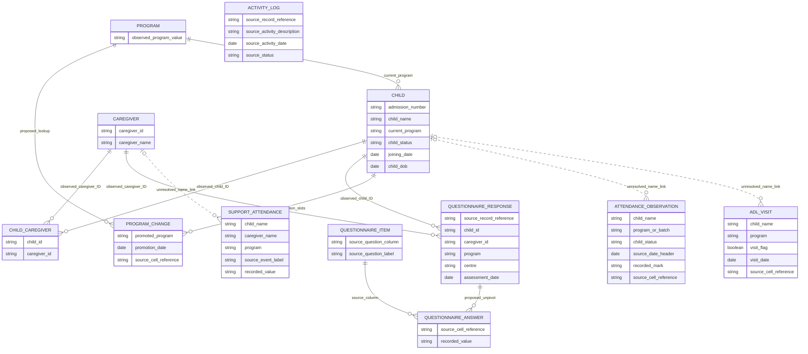

# Stage 1 — Entity relationship diagram

Draft for analyst approval. Solid edges show source ID equality or a proposed unpivot of observed repeated columns; dotted edges are unresolved name-based links. Cardinalities are recommendations, not database constraints. Types are conceptual. Source-record/cell references are derived technical lineage, not invented NGO fields.

See [entities and field evidence](03-entity-discovery.md) and [conceptual model](05-conceptual-data-model.md) for source ranges, key scope and relationship limitations. No physical table or foreign key has been created. The graph includes an unlinked activity-log entity because its participant grain is unresolved.
