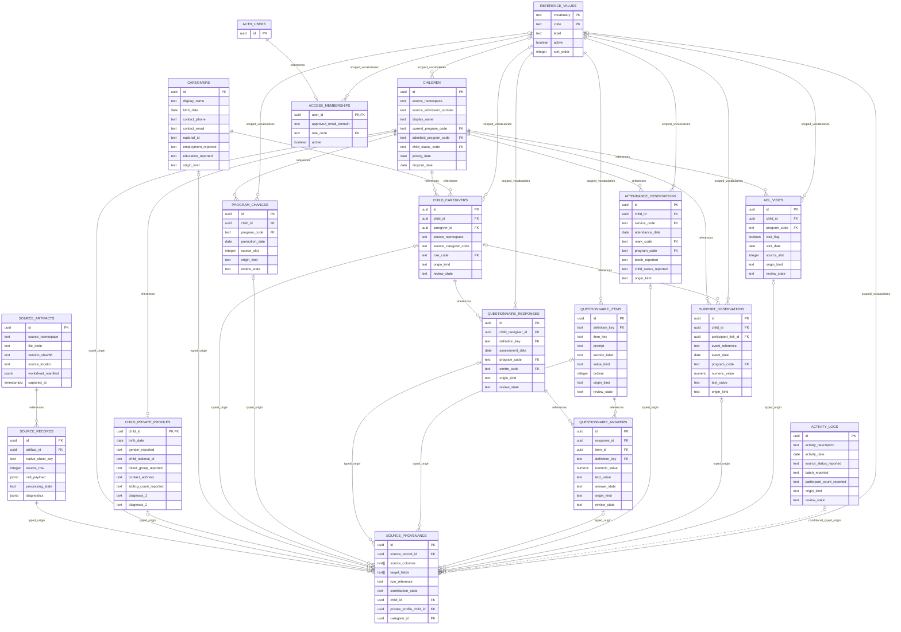

# Stage 2 — Revised draft ER diagram

**DRAFT, not an implemented database.** Seventeen proposed tables: sixteen core and conditional ACTIVITY_LOGS. AUTH_USERS is Supabase-managed and excluded from that count. Common audit FKs to AUTH_USERS are omitted for readability; full fields/keys are in the model specification. Grouped lookup edges represent separate vocabulary-scoped FKs. Optional target edges in SOURCE_PROVENANCE are mutually exclusive per row, not simultaneous links to every entity. A dotted edge marks the optional activity extension.

Curated attendance requires resolved identity/date; unresolved source strings are retained in SOURCE_RECORDS rather than falsely becoming valid FKs. Questionnaire pair and answer-definition relationships are proposed constraints based on observed evidence, still subject to analyst approval. Child-to-caregiver and repeated-response cardinalities describe the proposed capacity, not proof of existing person scope or longitudinal behavior.

For the 16-table variant omit ACTIVITY_LOGS and its SOURCE_PROVENANCE activity pointer/FK/index/target group as one activation unit. See [full optimized model](11-optimized-data-model.md), [comparison](12-data-model-comparison-matrix.md) and [original 12-entity diagram](archive/stage1-er-diagram.md). Diagram syntax/reference checks do not validate business rules or prove rendered layout quality.
