> Historical milestone preserved. Current deployed 20-table model and final results: [Phase 1 handover](PHASE1-HANDOVER.md), [final dictionary](FINAL-DATA-DICTIONARY.md), [actual ER diagram](visual/final-deployed-er.svg).

# Deployed ER model — current Phase 1 schema

19 deployed application/evidence tables, verified against the live Tokyo project. AUTH_USERS is managed by Supabase and excluded from that count. The compact Mermaid below omits common audit-actor links; the [catalog-derived visual](visual/deployed-er.svg), [all 99 exact FK relationships](visual/deployed-er.mmd) and [readable key reference](visual/deployed-keys.md) reflect the actual schema. Provenance targets are mutually exclusive; identity candidates are not approved observations. See [current handover](37-phase1-handover-summary.md).

```mermaid
erDiagram
    REFERENCE_VALUES {
        text vocabulary PK
        text code PK
    }
    CHILDREN {
        uuid id PK
        text current_program_code FK
        text admitted_program_code FK
        text child_status_code FK
        text child_business_id
    }
    CHILD_PRIVATE_PROFILES {
        uuid child_id PK
    }
    CAREGIVERS {
        uuid id PK
        text caregiver_business_id
    }
    CHILD_CAREGIVERS {
        uuid id PK
        uuid child_id FK
        uuid caregiver_id FK
        text role_code FK
    }
    PROGRAM_CHANGES {
        uuid id PK
        uuid child_id FK
        text program_code FK
    }
    QUESTIONNAIRE_RESPONSES {
        uuid id PK
        uuid child_caregiver_id FK
        text definition_key FK
        text program_code FK
        text centre_code FK
    }
    QUESTIONNAIRE_ITEMS {
        uuid id PK
        text definition_key FK
    }
    QUESTIONNAIRE_ANSWERS {
        uuid id PK
        uuid response_id FK
        uuid item_id FK
        text definition_key FK
    }
    ATTENDANCE_OBSERVATIONS {
        uuid id PK
        uuid child_id FK
        text service_code FK
        text mark_code FK
        text program_code FK
    }
    SUPPORT_OBSERVATIONS {
        uuid id PK
        uuid child_id FK
        uuid participant_link_id FK
        text program_code FK
    }
    ADL_VISITS {
        uuid id PK
        uuid child_id FK
        text program_code FK
    }
    SOURCE_ARTIFACTS {
        uuid id PK
    }
    SOURCE_RECORDS {
        uuid id PK
        uuid artifact_id FK
    }
    SOURCE_PROVENANCE {
        uuid id PK
        uuid source_record_id FK
        uuid child_id FK
        uuid private_profile_child_id FK
        uuid caregiver_id FK
        uuid child_caregiver_id FK
        uuid program_change_id FK
        uuid response_id FK
        uuid item_id FK
        uuid answer_id FK
        uuid attendance_id FK
        uuid support_id FK
        uuid adl_id FK
        text reference_code FK
    }
    ACCESS_MEMBERSHIPS {
        uuid user_id PK
        text role_code FK
    }
    IDENTITY_CANDIDATES {
        uuid id PK
        uuid source_record_id FK
        uuid child_id FK
        uuid caregiver_id FK
    }
    RECOVERY_ACTIONS {
        uuid id PK
        uuid source_record_id FK
        uuid donor_source_record_id FK
        uuid child_id FK
        uuid caregiver_id FK
    }
    RECORD_AUDIT_EVENTS {
        uuid id PK
    }
    AUTH_USERS {
        uuid id PK
    }
    REFERENCE_VALUES o|--o{ CHILDREN : program_vocabulary_current_program_code
    REFERENCE_VALUES o|--o{ CHILDREN : program_vocabulary_admitted_program_code
    REFERENCE_VALUES o|--o{ CHILDREN : status_vocabulary_child_status_code
    CHILDREN ||--o| CHILD_PRIVATE_PROFILES : child_id
    CHILDREN ||--o{ CHILD_CAREGIVERS : child_id
    CAREGIVERS ||--o{ CHILD_CAREGIVERS : caregiver_id
    REFERENCE_VALUES o|--o{ CHILD_CAREGIVERS : role_vocabulary_role_code
    CHILDREN ||--o{ PROGRAM_CHANGES : child_id
    REFERENCE_VALUES o|--o{ PROGRAM_CHANGES : program_vocabulary_program_code
    CHILD_CAREGIVERS ||--o{ QUESTIONNAIRE_RESPONSES : child_caregiver_id
    REFERENCE_VALUES ||--o{ QUESTIONNAIRE_RESPONSES : definition_vocabulary_definition_key
    REFERENCE_VALUES o|--o{ QUESTIONNAIRE_RESPONSES : program_vocabulary_program_code
    REFERENCE_VALUES o|--o{ QUESTIONNAIRE_RESPONSES : centre_vocabulary_centre_code
    REFERENCE_VALUES ||--o{ QUESTIONNAIRE_ITEMS : definition_vocabulary_definition_key
    QUESTIONNAIRE_RESPONSES ||--o{ QUESTIONNAIRE_ANSWERS : response_id_definition_key
    QUESTIONNAIRE_ITEMS ||--o{ QUESTIONNAIRE_ANSWERS : item_id_definition_key
    CHILDREN ||--o{ ATTENDANCE_OBSERVATIONS : child_id
    REFERENCE_VALUES ||--o{ ATTENDANCE_OBSERVATIONS : service_vocabulary_service_code
    REFERENCE_VALUES ||--o{ ATTENDANCE_OBSERVATIONS : mark_vocabulary_mark_code
    REFERENCE_VALUES o|--o{ ATTENDANCE_OBSERVATIONS : program_vocabulary_program_code
    CHILDREN ||--o{ SUPPORT_OBSERVATIONS : child_id
    CHILD_CAREGIVERS o|--o{ SUPPORT_OBSERVATIONS : participant_link_id_child_id
    REFERENCE_VALUES o|--o{ SUPPORT_OBSERVATIONS : program_vocabulary_program_code
    CHILDREN ||--o{ ADL_VISITS : child_id
    REFERENCE_VALUES o|--o{ ADL_VISITS : program_vocabulary_program_code
    SOURCE_ARTIFACTS ||--o{ SOURCE_RECORDS : artifact_id
    SOURCE_RECORDS ||--o{ SOURCE_PROVENANCE : source_record_id
    CHILDREN o|--o{ SOURCE_PROVENANCE : child_id
    CHILD_PRIVATE_PROFILES o|--o{ SOURCE_PROVENANCE : private_profile_child_id
    CAREGIVERS o|--o{ SOURCE_PROVENANCE : caregiver_id
    CHILD_CAREGIVERS o|--o{ SOURCE_PROVENANCE : child_caregiver_id
    PROGRAM_CHANGES o|--o{ SOURCE_PROVENANCE : program_change_id
    QUESTIONNAIRE_RESPONSES o|--o{ SOURCE_PROVENANCE : response_id
    QUESTIONNAIRE_ITEMS o|--o{ SOURCE_PROVENANCE : item_id
    QUESTIONNAIRE_ANSWERS o|--o{ SOURCE_PROVENANCE : answer_id
    ATTENDANCE_OBSERVATIONS o|--o{ SOURCE_PROVENANCE : attendance_id
    SUPPORT_OBSERVATIONS o|--o{ SOURCE_PROVENANCE : support_id
    ADL_VISITS o|--o{ SOURCE_PROVENANCE : adl_id
    REFERENCE_VALUES o|--o{ SOURCE_PROVENANCE : reference_vocabulary_reference_code
    AUTH_USERS ||--o| ACCESS_MEMBERSHIPS : user_id
    REFERENCE_VALUES ||--o{ ACCESS_MEMBERSHIPS : role_vocabulary_role_code
    SOURCE_RECORDS ||--o{ IDENTITY_CANDIDATES : source_record_id
    CHILDREN o|--o{ IDENTITY_CANDIDATES : child_id
    CAREGIVERS o|--o{ IDENTITY_CANDIDATES : caregiver_id
    SOURCE_RECORDS ||--o{ RECOVERY_ACTIONS : source_record_id
    CHILDREN o|--o{ RECOVERY_ACTIONS : child_id
    CAREGIVERS o|--o{ RECOVERY_ACTIONS : caregiver_id
    SOURCE_RECORDS o|--o{ RECOVERY_ACTIONS : donor_source_record_id
```

See [complete specification](15-final-data-model.md), [target dictionary](06-data-dictionary-draft.md), and [previous 17-table diagram](archive/stage2-er-diagram.md).
